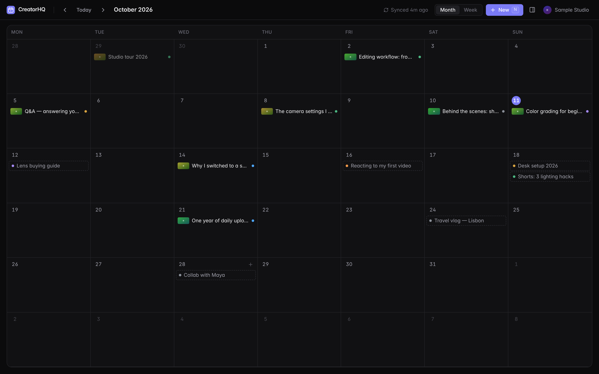
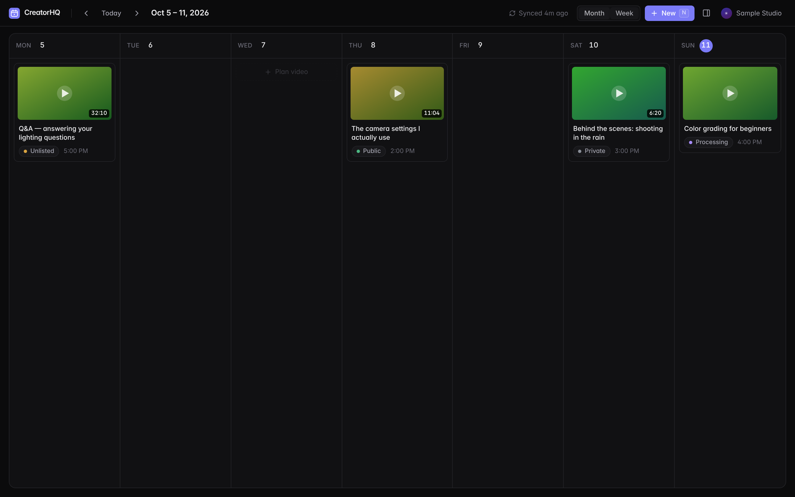
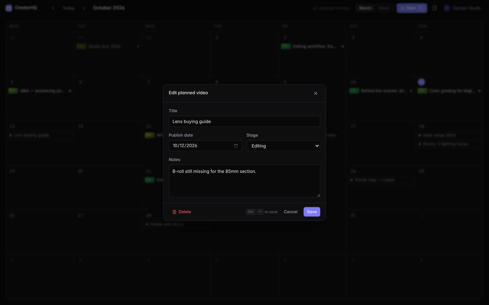
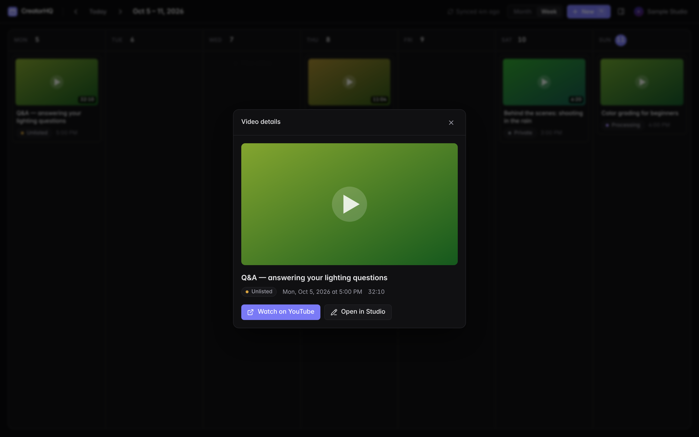
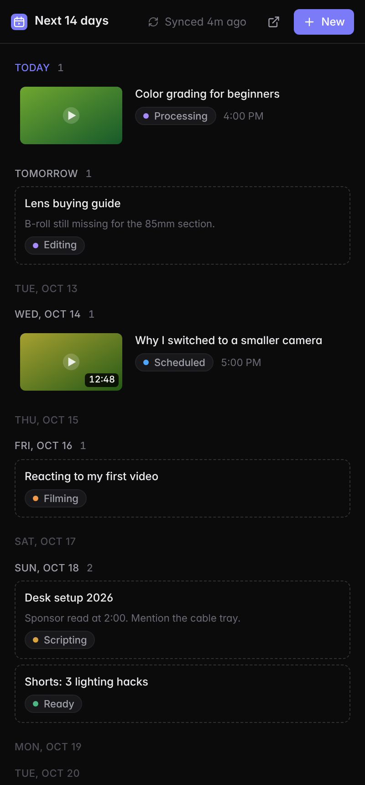

# CreatorHQ

A content calendar for YouTube creators, as a Chrome extension. Connect your channel and your
published, scheduled, unlisted and private uploads land on a month or week calendar. Your plans for
videos you haven't made yet sit on the same calendar. Drag them to reschedule.



<table>
  <tr>
    <td></td>
    <td></td>
  </tr>
  <tr>
    <td></td>
    <td align="center"></td>
  </tr>
</table>

<sub>Screenshots use sample data with generated thumbnails. They come from <code>pnpm smoke</code>, not a real channel.</sub>

## What it does

- **Reads your channel.** For each video it shows the title, thumbnail, publish date, link and status:
  public · scheduled · unlisted · private · processing · failed. A scheduled video sits on the day it goes
  live, not the day you uploaded it.
- **Plans what's next.** You can add a planned video with a title, date, stage (idea → scripting → filming →
  editing → ready) and notes. Click to edit it, drag to reschedule it.
- **Two views of the same data.**
  - Clicking the toolbar icon opens the full calendar in a tab.
  - Right-clicking the icon and choosing *Open agenda in side panel* opens the next 14 days in a
    compact list next to YouTube Studio.
  - An edit in either one shows up in the other immediately.
- **Read-only and local.** It only asks for `youtube.readonly`, so it can't change your channel. Plans and
  the video cache live in `chrome.storage.local` on this machine, and nothing is sent anywhere except the
  YouTube Data API.

**Keyboard:** <kbd>N</kbd> new · <kbd>T</kbd> today · <kbd>←</kbd>/<kbd>→</kbd> previous/next ·
<kbd>M</kbd>/<kbd>W</kbd> month/week · <kbd>Esc</kbd> close · <kbd>⌘/Ctrl</kbd>+<kbd>↵</kbd> save.

## Setup

You need Node 20+ and pnpm, plus a Google Cloud OAuth client (free, about 5 minutes).

```bash
pnpm install
pnpm keygen          # prints your extension ID and a VITE_EXTENSION_KEY line
cp .env.example .env.local
```

### 1. Pin the extension ID

Google binds an OAuth client to one extension ID. An unpacked extension's ID normally depends on
the folder it's loaded from, so `pnpm keygen` makes a key that fixes it. Paste the printed
`VITE_EXTENSION_KEY=…` line into `.env.local` and note the extension ID.

### 2. Create the OAuth client

In the [Google Cloud console](https://console.cloud.google.com/):

1. Create a project, or pick an existing one.
2. Go to **APIs & Services → Library**, find **YouTube Data API v3**, and click **Enable**.
3. Go to **APIs & Services → OAuth consent screen**:
   - Choose **External**.
   - Fill in the app name and your email.
   - Add the scope `.../auth/youtube.readonly`.
   - Under **Test users**, add the Google account that owns your channel. While the app is in
     *Testing*, only test users can sign in.
4. Go to **APIs & Services → Credentials → Create credentials → OAuth client ID**:
   - Application type: **Chrome Extension**.
   - Item ID: the extension ID from `pnpm keygen`.
5. Copy the client ID into `.env.local` as `VITE_GOOGLE_CLIENT_ID=…`.

### 3. Build and load

```bash
pnpm build
```

Open `chrome://extensions`, turn on **Developer mode**, click **Load unpacked**, and pick `dist/`.
Check that the ID Chrome shows matches the one from step 1. Click the toolbar icon, then **Connect**.

For development, `pnpm dev` serves with hot reload. Load `dist/` once and it updates live.

## Scripts

| Command | What it does |
|---|---|
| `pnpm dev` | Vite dev server with HMR into the loaded extension |
| `pnpm build` | Typecheck, then build to `dist/` |
| `pnpm test` | Unit tests (Vitest): date math, grouping, API mapping, storage, client errors |
| `pnpm lint` / `pnpm typecheck` | ESLint / `tsc -b` |
| `pnpm smoke` | Loads `dist/` in headless Chromium and drives the real UI end to end, then writes the screenshots above. Set `CHROMIUM_PATH` if Playwright's browser isn't installed. |
| `pnpm keygen` | Generate the extension key and print the extension ID |

## Architecture

```
src/
  core/        Pure TypeScript: domain types, date math, grouping. No React, no chrome.*
  services/    The outside world, behind small interfaces
    auth.ts        chrome.identity token provider + sign-out (revokes the grant)
    youtube/       fetch client (401 → refresh token, retry once; typed errors), API calls, response mappers
    storage/       typed repos over chrome.storage.local (one key per planned video)
  state/       Zustand stores: videos (sync), planned (CRUD), ui (view, date, dialogs)
               bootstrap.ts hydrates from storage and listens to storage.onChanged,
               which is how the tab and the side panel stay in sync
  components/  ui/ primitives · calendar/ month + week · planner/ · video/ · agenda/ · auth/
  pages/       app/ (calendar tab) · sidepanel/ — thin entry points
  background/  service worker: toolbar click and context menu
```

Data flows in one direction: **services → stores → components**. Components never call `chrome.*` or
`fetch`. `core/` and `services/` take their dependencies as parameters, such as a token provider, a
`fetch`, or a storage area. That's why they're unit-tested without a browser.

**How syncing works.**
- Opening the calendar shows the cached videos instantly.
- If the cache is more than 15 minutes old, it refreshes in the background.
- The refresh button forces a sync.
- One sync costs: 1 quota unit for the channel, 1 per 50 uploads for IDs, and 1 per 50 uploads for
  details. 1,000 videos is about 41 units of the default 10,000/day quota.
- A sync reads at most the 1,000 most recent uploads (`MAX_UPLOADS` in `services/youtube/api.ts`).

**Why no calendar library.**
- A month grid is 42 dates from `date-fns`, and a week is 7.
- Owning the markup keeps the bundle small (about 88 KB gzipped, total) and keeps the look exactly as
  designed.

## Limitations

- **Chrome only.** `chrome.identity.getAuthToken` isn't available in Edge, Brave or Arc. Supporting them
  means switching to `launchWebAuthFlow`, which also means handling token expiry yourself.
- **One channel.** It uses the channel of the Google account you pick at sign-in. Brand accounts work if
  you pick them in the account chooser.
- **Plans stay on one machine.** They're in `chrome.storage.local` and don't sync across devices.
- **No two-way sync.** Plans don't get uploaded or scheduled on YouTube, and YouTube videos can't be
  edited from here.
- **No live sign-in test yet.** The YouTube path is covered by unit tests against API-shaped fixtures, and
  the UI by `pnpm smoke` with sample data. A real sign-in needs your OAuth client.
